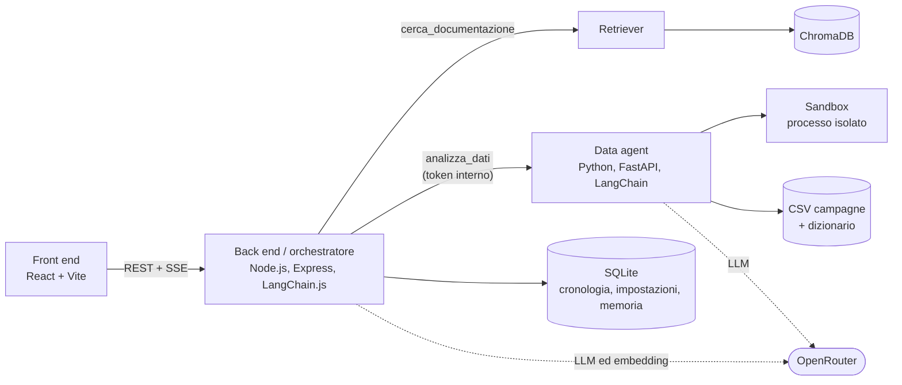

# Wayfare Media Agents

Agente AI ibrido per il reparto **Media Sales & Campaign Performance** di Wayfare Media, concessionaria
pubblicitaria (fittizia) di otto aeroporti italiani. Risponde in italiano a due tipi di domande, e alle loro
combinazioni:

- **regole e procedure** ("che penale si applica se il cliente cancella 10 giorni prima?"): ricerca nella
  documentazione aziendale (RAG su ChromaDB), con citazioni cliccabili alle sezioni dell'handbook;
- **numeri sulle campagne** ("CPM effettivo per formato, con un grafico"): un analista dati Python che pulisce
  il dataset, scrive ed esegue codice pandas in una sandbox, produce grafici matplotlib/seaborn e una sintesi.

Le domande miste ("quali campagne Lusso hanno diritto a un make-good?") usano entrambi: prima la regola con le
sue esclusioni, poi l'analisi dei dati con la regola scritta per esteso.

Progetto finale del modulo "Sviluppa un agente AI avanzato" del master S2I. Dati e azienda sono sintetici.

## Funzionalità

- **Chat in streaming** con il ragionamento dell'agente in un pannello richiudibile (strumenti usati, motivo,
  durata, fonti, pulizia dei dati, codice) e la risposta in Markdown.
- **Citazioni navigabili**: `[§4.3]` apre il documento in un pannello laterale (anche a schermo intero) con la
  sezione evidenziata.
- **Analisi dei dati** con scheda Grafico / Dati / Codice, mostrata a risposta completa.
- **Modello effettivo** sotto ogni risposta (modello, provider e costo, dai dati di OpenRouter), con un avviso se
  ha risposto un modello di riserva al posto di quello scelto.
- **Cronologia** delle conversazioni salvata sul server, con eliminazione; memoria dell'agente persistente.
- **Knowledge Base** consultabile e modificabile: documenti (reindicizzati a ogni salvataggio), dati grezzi e
  puliti con modifica delle celle, dizionario dati, pulizia con analisi della qualità e codice.
- **Identità visiva** in stile modernismo italiano, con tema chiaro e scuro e contrasto verificato
  ([docs/brand](docs/brand/README.md)).
- **Impostazioni**: chiave OpenRouter, modello linguistico e modello di embedding scelti dai cataloghi di
  OpenRouter, oppure embedding calcolati in locale con verifica delle risorse della macchina.

## Architettura



| Componente | Cartella | Ruolo |
|---|---|---|
| Front end | `frontend/` | Interfaccia in italiano: chat, Knowledge Base, Impostazioni |
| Back end | `backend/` | API, orchestratore ReAct (LangChain.js `createAgent`) con due strumenti, RAG, persistenza |
| Data agent | `data_agent/` | Microservizio interno: analisi della qualità, pulizia verificata, agente pandas, grafici |
| Dati | `data/` | Dataset sintetico (9.293 righe con anomalie), dizionario dati, handbook, generatore |
| Documentazione | `docs/` | [Architettura e decisioni](docs/architettura.md), handbook in PDF |
| Valutazione | `eval/` | [Casi, script e risultati](eval/README.md) della valutazione dell'orchestrazione |

I dettagli (flussi, pipeline RAG e di pulizia, sicurezza, scelte progettuali e loro motivazioni) sono in
[docs/architettura.md](docs/architettura.md). Le modifiche, commit per commit, sono in [CHANGELOG.md](CHANGELOG.md).

## Stack

| Livello | Tecnologie (versioni fissate) |
|---|---|
| Front end | React 19.3.1, Vite 8.3.8, react-markdown 10.1.0 |
| Back end | Node.js 24, Express 5.3.0, LangChain.js (`langchain` 1.6.6, `@langchain/langgraph` 1.7.5), zod 4.6.7, pino 10.4.0, better-sqlite3 12.11.1, Transformers.js 4.3.2 |
| Data agent | Python 3.13, FastAPI 0.165.0, LangChain 1.5.2, pandas 3.1.1, matplotlib 3.11.2, seaborn 0.13.2 |
| Vector store | ChromaDB 1.5.9 (client JS 3.5.0), spazio coseno |
| Modelli | Via OpenRouter (vendor-agnostic). Predefinito Claude Haiku 5.5, riserva DeepSeek V4.1 Flash (altro fornitore); embedding Nemotron 3.5 Embed |

Tutte le dipendenze sono fissate a versioni esatte (`save-exact` per npm, `requirements.txt` generato da
`requirements.in` per Python).

## Chiave API

Per usare l'app va inserita una API key di [OpenRouter](https://openrouter.ai/keys): è l'unico servizio esterno, e
con una sola chiave dà accesso ai modelli di tutti i fornitori (orchestratore, analista dati ed embedding).
La chiave si inserisce in `OPENROUTER_API_KEY` nel file `.env` oppure, ad app avviata, in **Impostazioni**: viene
verificata con OpenRouter, resta solo sul server e non viene mai restituita al browser.

Chi ha già chiavi di altri fornitori (Anthropic, OpenAI, Google, ...) può collegarle all'account OpenRouter con
il [BYOK](https://openrouter.ai/docs/guides/overview/auth/byok) (*Bring Your Own Key*): l'app continua a usare la chiave
OpenRouter, mentre le chiamate ai modelli di quei fornitori vengono addebitate sulle loro chiavi (secondo le
condizioni di OpenRouter, che può applicare una piccola commissione).

Una valutazione completa (20 casi) con il modello predefinito costa pochi centesimi di dollaro.

## Avvio con Docker (consigliato)

Prerequisiti: Docker con Compose v2 e una chiave [OpenRouter](https://openrouter.ai/keys).

```bash
cp .env.example .env            # inserisci una API key di OpenRouter e un DATA_AGENT_TOKEN casuale (openssl rand -hex 32)
docker compose up -d --build
docker compose ps               # attendi che backend risulti "healthy"
# apri http://localhost:8080
```

Al primo avvio il data agent fa scrivere all'AI il codice di pulizia del dataset e lo verifica (1-2 minuti):
nel frattempo la chat risponde alle domande sulla documentazione e l'indicatore di stato segnala i dati in
preparazione. Ai riavvii successivi la pulizia è già in cache.

| Servizio | Ruolo | Esposto |
|---|---|---|
| `frontend` | nginx con la build statica, inoltra `/api` al back end | `127.0.0.1:8080` (`WAYFARE_PORT` per cambiarla) |
| `backend` | orchestratore e API | no |
| `ingest` | indicizza la documentazione e termina (idempotente) | no |
| `data-agent` | analisi e pulizia dei dati | no |
| `chroma` | vector store | no |

I container girano come utenti non privilegiati, con filesystem in sola lettura, nessuna capability Linux e
`no-new-privileges`; scrivono solo nei volumi (`storage`, `kb`, `dataset`, `analysis-cache`, `charts`,
`chroma`). Per ripartire da zero: `docker compose down -v`.

## Avvio in locale, senza Docker

Prerequisiti: Node.js 24 (`.nvmrc`), Python 3.13 (`.python-version`), Docker (per ChromaDB), una chiave
[OpenRouter](https://openrouter.ai/keys).

```bash
# 1. Configurazione
cp .env.example .env            # inserisci una API key di OpenRouter e un DATA_AGENT_TOKEN casuale

# 2. ChromaDB
docker run -d --name chroma -p 127.0.0.1:8000:8000 -v "$PWD/chroma_data:/data" chromadb/chroma:1.5.9

# 3. Data agent (porta 8001)
cd data_agent
python -m venv .venv && .venv/bin/pip install -r requirements.txt
.venv/bin/uvicorn app.main:app --host 127.0.0.1 --port 8001
# al primo avvio prepara il dataset pulito (l'AI scrive il codice di pulizia, poi resta in cache)

# 4. Back end (porta 3001), in un altro terminale
cd backend
npm ci
npm run ingest                  # indicizza la documentazione in ChromaDB (idempotente)
npm start

# 5. Front end (porta 5173), in un altro terminale
cd frontend
npm ci
npm run dev                     # apri http://localhost:5173
```

Note:

- `npm ci` nel back end non esegue gli script di installazione di `onnxruntime-node` (`backend/.npmrc`): per
  l'esecuzione su CPU bastano i binari inclusi nel pacchetto e si evita il download delle librerie CUDA.
- I modelli di embedding locali si scaricano dall'interfaccia (Impostazioni → Modello di embedding → Locale)
  oppure al primo avvio con `EMBEDDING_PROVIDER=local`.

## Test

```bash
(cd backend && npm test)        # orchestratore (modello finto), API, RAG, persistenza, embedding
(cd frontend && npm test)       # parser SSE, citazioni, formattazione
(cd data_agent && .venv/bin/pip install -r requirements-dev.txt && .venv/bin/pytest)   # sandbox, qualità, API
(cd data_agent && .venv/bin/pytest -m llm)    # opzionale: chiama davvero il modello e confronta con il ground truth
```

Lint: `npm run lint` in `backend/` e `frontend/` (ESLint, con le regole degli hook di React nel front end) e
`.venv/bin/ruff check .` in `data_agent/`. Gli strumenti di test e lint del data agent sono in
`requirements-dev.txt` e non entrano nell'immagine Docker.

I test predefiniti non usano la rete né consumano crediti: il back end usa un modello finto deterministico
(`backend/test/fakeModel.js`) che simula anche lo streaming. Il dataset ha un ground truth
(`data/generator/ground_truth.json`) con il numero di anomalie iniettate e i KPI attesi, usato per verificare
sia la pulizia sia l'analisi della qualità.

### Valutazione dell'orchestrazione

`node eval/run.mjs` pone 20 domande realistiche all'agente in esecuzione (documentazione, dati, regole applicate
ai dati, conversazione e fuori ambito, domande di seguito) e verifica strumenti usati, citazioni e numeri
rispetto al ground truth. Confronto tra tre modelli economici di tre fornitori, a parità di casi: Claude Haiku
5.5 supera 20/20 casi, DeepSeek V4.1 Flash 19/20, GPT-6 Luna 17/20; ogni giro costa da 0,01 a 0,06 USD. Haiku è
diventato il modello predefinito e, nella configurazione finale (con la riserva attiva), supera 20/20 casi con
risposta mediana in 4,4 s e 0,05 USD per l'intera valutazione. Metodo, risultati e problemi emersi in
[eval/README.md](eval/README.md).

## Sicurezza

- **Segreti**: `.env` è escluso da git; la chiave impostata dall'interfaccia è salvata solo sul server (SQLite,
  file con permessi `0600`), non viene mai restituita al browser (solo mascherata) né scritta nei log
  (redazione in pino).
- **Data agent**: raggiungibile solo dal back end, con token condiviso (`X-Internal-Token`, confronto a tempo
  costante). Il codice generato dall'LLM gira in un processo separato senza segreti, con policy statica
  sugli import e sulle funzioni, timeout per esecuzione e limite di concorrenza.
- **API**: validazione di ogni input con zod (FastAPI/pydantic nel data agent), limiti di dimensione delle
  richieste, rate limit generale e più stretto sulla chat, helmet, CORS ristretto, errori verso l'utente in
  italiano senza dettagli interni.
- **Modelli locali**: revisione fissata e SHA-256 verificato al download; a runtime nessun accesso a Hugging Face.
- **Limite noto**: non c'è autenticazione degli utenti. L'applicazione è pensata per uso locale o su una rete
  interna; un deployment pubblico richiederebbe un livello di autenticazione davanti al back end.

## Dati

- `data/campagne_wayfare.csv`: 9.293 righe (una campagna, in un aeroporto, in un giorno; gen 2025 - set 2026)
  con anomalie realistiche: duplicati, date in tre formati, CPM scritti come testo in valuta italiana,
  categorie scritte in modi diversi, valori mancanti o impossibili.
- `data/dizionario_dati.md`: tipi, valori ammessi e regole di qualità e di calcolo. È la fonte delle regole
  per l'analisi della qualità e per la pulizia, ed è modificabile dall'interfaccia.
- `data/kb/`: documentazione indicizzata. Sono supportati Markdown, testo (`.txt`) e PDF (testo estratto con
  `unpdf`, citazioni con il numero di pagina). Dall'interfaccia si creano e modificano documenti Markdown; file
  `.txt` o `.pdf` si aggiungono copiandoli in `data/kb/` e rieseguendo `npm run ingest`.
  `docs/wayfare_media_handbook.pdf` è l'esportazione dell'handbook e si può usare per provare l'indicizzazione di un PDF.
- `data/generator/`: generatore riproducibile (seed fisso) del dataset e del PDF, con il ground truth.
