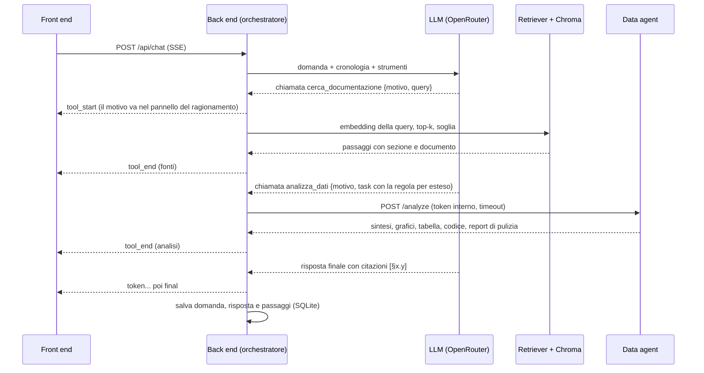

# Architettura e decisioni

Questo documento descrive come è fatto il sistema e perché. Per installazione, test e sicurezza in breve vedi il
[README](../README.md); per la storia delle modifiche il [CHANGELOG](../CHANGELOG.md).

## 1. Componenti

Tre servizi applicativi più un vector store, ciascuno con una responsabilità sola. Gli indirizzi tra servizi
arrivano da variabili d'ambiente, quindi ogni componente può girare sulla stessa macchina, in container
separati o su host diversi senza modifiche al codice.

| Servizio | Responsabilità | Non fa |
|---|---|---|
| Front end (`frontend/`) | Presentazione: chat in streaming, Knowledge Base, Impostazioni | Nessuna logica di dominio, nessun segreto |
| Back end (`backend/`) | Orchestrazione (sceglie lo strumento), RAG, persistenza, impostazioni, unico punto d'accesso per il browser | Non esegue codice generato dall'LLM |
| Data agent (`data_agent/`) | Tutto ciò che tocca il dataset: qualità, pulizia, analisi, grafici | Non è raggiungibile dal browser |
| ChromaDB | Vettori e metadati dei passaggi della documentazione | Non calcola gli embedding (li calcola il back end) |

## 2. Il percorso di una domanda

### Orchestratore (`backend/src/agent.js`)

- Agente ReAct con `createAgent` di LangChain.js v1 e due strumenti: `cerca_documentazione` e `analizza_dati`.
  È il modello a decidere quale usare, guidato da regole esplicite nel prompt di sistema: regole → documentazione,
  numeri → analista, regola applicata ai dati → prima la regola con le sue **esclusioni**, poi l'analisi con la
  regola scritta per esteso. Il compito per l'analista deve essere autosufficiente, perché l'analista non ha
  memoria della conversazione.
- Gli strumenti restituiscono `content_and_artifact`: il testo va al modello, i dati strutturati (fonti,
  grafici, tabelle) vanno all'interfaccia senza passare dal modello.
- Middleware: limite di chiamate al modello per turno (niente loop), retry sugli errori transitori del provider,
  context editing (nelle conversazioni lunghe i vecchi output degli strumenti vengono sostituiti da un segnaposto).
- Memoria per conversazione con un checkpointer SQLite (`thread_id` = id della conversazione).
- **Ragionamento visibile**: ogni strumento ha un parametro `motivo`, una frase per l'utente. Il ragionamento
  viaggia quindi con la chiamata allo strumento e l'interfaccia lo colloca subito nel pannello del ragionamento.
  Come rete di sicurezza, il testo libero del modello viene trattenuto fino a 160 caratteri: se nel frattempo
  arriva una chiamata a uno strumento era un ragionamento e non compare mai come inizio della risposta.

Eventi SSE verso il front end: `status`, `tool_start`, `tool_end`, `token`, `final`, `error`.

## 3. Documentazione e RAG (`backend/src/rag/`, `backend/src/embeddings/`)

**Indicizzazione.** La fonte canonica è il Markdown in `data/kb/` (modificabile dall'interfaccia); i PDF sono
comunque supportati. Il documento viene diviso nelle sue sezioni seguendo i titoli (numerazione esplicita, come
`## 4.3 Cancellazione`, o automatica), poi in passaggi da 900 caratteri con sovrapposizione di 150 che non
attraversano mai il confine di una sezione. Ogni passaggio porta un'intestazione di contesto
("Handbook › 4.3 Cancellazione") che entra anche nell'embedding, e nei metadati documento, sezione e titolo.
L'indicizzazione è idempotente: un documento invariato (stesso SHA-256) non viene ricalcolato. Le scritture
passano da una coda, una alla volta.

**Ricerca.** Embedding della domanda, top-k (5) per similarità coseno, scarto dei passaggi sotto la soglia di
pertinenza. Il modello riceve i passaggi con l'indicazione di come citarli (`[§4.3]`); l'interfaccia trasforma
le citazioni in pulsanti che aprono il documento sulla sezione.

**Modelli di embedding.** Scelti dall'interfaccia: un modello del catalogo OpenRouter, oppure un modello locale
eseguito con Transformers.js su CPU (E5 Small, E5 Base, BGE-M3), così documenti e domande non escono dal server
per indicizzazione e ricerca.

- Ogni modello ha la sua collection: vettori di modelli diversi non sono confrontabili.
- Il cambio è un'operazione in background (download, caricamento, indicizzazione, verifica) e il nuovo modello
  diventa attivo solo se riesce; altrimenti resta il precedente.
- **Soglia calibrata per modello.** Ogni modello ha una scala di similarità diversa (misurato: E5 restituisce
  valori tra 0,7 e 0,9 per qualsiasi testo, Nemotron tra 0 e 0,6). Al cambio il sistema pone 8 domande
  chiaramente fuori tema e fissa la soglia al 75° percentile delle loro similarità migliori.
- Per i modelli locali il sistema valuta la macchina (CPU, RAM disponibile, disco, piattaforma, limiti del
  container) contro requisiti misurati, e scarica i file in streaming con revisione fissata e SHA-256 verificato.

## 4. Data agent (`data_agent/`)

### Preparazione del dataset

```mermaid
flowchart TD
  A[CSV grezzo + dizionario dati] --> Q[Analisi della qualità<br/>deterministica, tutte le righe]
  Q --> C{Dati e dizionario<br/>invariati?}
  C -- sì --> K[Cache]
  C -- solo i dati --> R[Riesegue il codice già validato]
  C -- no --> G[L'LLM scrive pulisci&#40;df&#41;<br/>da dizionario + analisi]
  R --> V{Controlli superati?}
  G --> S[Esecuzione in sandbox] --> V
  V -- sì --> OK[Dataset pulito in cache<br/>scrittura atomica]
  V -- no, codice riusato --> G
  V -- no, codice nuovo --> E[Errori all'LLM, nuovo tentativo<br/>max 3]
  E --> S
```

1. **Analisi della qualità** (`quality.py`, nessuna AI). Tipi, valori canonici, sinonimi e intervalli plausibili
   vengono letti dal dizionario dati. Ogni anomalia è riportata con numero di righe, esempi (`id_riga` e valore)
   e valore canonico proposto. Sul dataset sintetico ritrova esattamente le 13 anomalie iniettate dal
   generatore (verificato da un test sul ground truth).
2. **Codice di pulizia scritto dall'LLM**, a partire da dizionario e analisi, eseguito nella sandbox.
3. **Doppia verifica.** Controlli di business (`validate`: numero di righe, righe non valide, tipi, plausibilità
   dei CPM...) e la stessa analisi della qualità rieseguita sui dati puliti: le anomalie "bloccanti" devono
   essere zero, anche se presenti in una sola riga. In caso contrario gli errori tornano all'LLM.
4. **Riuso.** Se cambiano solo i dati, si riesegue il codice già validato senza chiamare l'LLM; se non supera più
   i controlli (es. un tipo di anomalia nuovo) si rigenera. Durante l'aggiornamento le analisi continuano sui
   dati precedenti.

### Analisi

Agente ReAct (`create_agent` di LangChain 1.x) con un interprete Python sul DataFrame pulito. Riproduce il
pattern del pandas agent di `langchain-experimental`, pacchetto dismesso a maggio 2026. Se finiscono i passi o
il tempo, un'ultima chiamata senza strumenti produce la risposta con i risultati già ottenuti, invece di perdere
il lavoro. I grafici sono salvati automaticamente come PNG; l'ultima tabella prodotta diventa la vista "Dati".

### Sandbox (`sandbox.py`)

Difesa a più livelli: policy statica sull'AST (import da una lista chiusa, niente accesso a file, processi o
introspezione), processo figlio avviato con `spawn` (non eredita la memoria del server, quindi nemmeno la
chiave), variabili d'ambiente sensibili rimosse, timeout per esecuzione, esecuzioni serializzate (alcuni modelli
chiamano più strumenti in parallelo). La policy è difesa in profondità; il confine di sicurezza è il processo.

## 5. Persistenza

| Dato | Dove | Note |
|---|---|---|
| Conversazioni, messaggi, impostazioni | `storage/app.db` (SQLite, WAL) | Permessi `0600`: può contenere la chiave impostata dall'interfaccia |
| Memoria dell'agente | `storage/checkpoints.db` | Checkpointer LangGraph, permessi `0600` |
| Modelli di embedding locali | `storage/models/` | Scaricati dall'interfaccia |
| Vettori | ChromaDB | Una collection per modello di embedding |
| Dataset pulito, codice e report | `data_agent/cache/` | Rigenerabile; scritture atomiche |
| Grafici | `data_agent/charts/` | Eliminati con la conversazione |

## 6. Catena dei timeout

Ogni livello aspetta più a lungo di quello che chiama, così l'errore nasce dove avviene il problema e
risale con un messaggio comprensibile:

front end 150 s > chat nel back end 120 s > chiamata al data agent 75 s > analisi 60 s (+ risposta finale
forzata) > singola esecuzione nella sandbox 15 s.

## 7. Decisioni

| Decisione | Motivazione |
|---|---|
| LLM via OpenRouter, API compatibile OpenAI | Vendor-agnostic: modello e provider si cambiano da configurazione o dall'interfaccia. Modelli economici in sviluppo, modelli migliori in produzione |
| Orchestratore in Node.js, analista in Python | Requisito del progetto, ed è la divisione naturale: I/O e streaming in Node, analisi dati nell'ecosistema pandas |
| `createAgent` di LangChain v1 con middleware | Pattern ReAct standard con limiti, retry e gestione del contesto dichiarativi, invece di un ciclo scritto a mano |
| Strumenti con `content_and_artifact` | Il modello riceve solo il testo che gli serve; grafici e tabelle arrivano all'interfaccia senza consumare token |
| Ragionamento come parametro `motivo` degli strumenti | Il testo libero del modello non si distingue dalla risposta finché non arriva la chiamata allo strumento: con un parametro dedicato il ragionamento è riconoscibile subito |
| Pulizia scritta dall'LLM ma verificata deterministicamente | L'AI generalizza a dati nuovi; i controlli garantiscono che il risultato sia corretto e ripetibile (stessi dati, stessi numeri) |
| Analisi della qualità guidata dal dizionario | Le regole stanno in un solo posto, modificabile da chi conosce il business; l'analisi non dipende da ciò che l'LLM nota |
| Markdown come fonte della documentazione | Modificabile dall'interfaccia, versionabile, sezioni precise per le citazioni; il PDF è un'esportazione |
| Una collection per modello di embedding | Cambiare modello non distrugge l'indice precedente: il cambio è reversibile e il ritorno è quasi istantaneo |
| Embedding locali con Transformers.js nel back end | Nessun servizio aggiuntivo; ONNX quantizzato su CPU; catalogo curato perché ogni famiglia richiede pooling e prefissi propri |
| SQLite per cronologia e impostazioni | Persistenza server-side senza un database da gestire; adatto a un uso interno |
| SSE consumato con `fetch` | `EventSource` non supporta POST; `fetch` permette corpo JSON, interruzione e timeout |
| Grafici PNG (matplotlib/seaborn) | Requisito del progetto; la vista "Dati" affianca la tabella con i numeri |
| JavaScript, non TypeScript | Scelta del progetto; i confini sono tipizzati a runtime con zod (back end) e pydantic (data agent) |

## 8. Limiti noti

- Nessuna autenticazione degli utenti: uso locale o su rete interna.
- Le domande che applicano regole articolate ai dati (es. make-good con esclusioni) richiedono più chiamate
  all'analista e con i modelli più lenti possono superare il tempo massimo della chat.
- I modelli di embedding locali sono un po' meno precisi di Nemotron sul primo risultato, ma recuperano quasi
  sempre la sezione giusta tra i primi passaggi passati all'agente.
- Con un modello di embedding locale i passaggi recuperati fanno comunque parte del prompt inviato al modello
  linguistico su OpenRouter: non esce la documentazione intera, ma quei passaggi sì.
